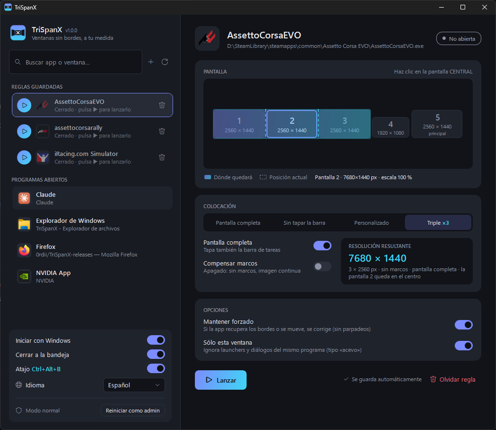

# TriSpanX

**Ventanas sin bordes y triple pantalla para Windows**, pensado para sim racing.

Pon cualquier juego o programa en ventana sin bordes a pantalla completa, en la pantalla que quieras o
extendido a **tres monitores (×3)**, sin cambiar la resolución.

## Descargar

Ve a **[Releases](../../releases/latest)** y descarga:

- **`TriSpanX.exe`** — ligero (menos de 1 MB). Necesita el
  [.NET Desktop Runtime 10](https://dotnet.microsoft.com/download/dotnet/10.0) (Windows te lo pide si falta).
- **`TriSpanX-portable.exe`** — no necesita instalar nada.

TriSpanX **se actualiza solo** al arrancar.

## Características

- Mapa visual de tus pantallas con vista previa de dónde quedará la ventana.
- Modos: pantalla completa, sin tapar la barra de tareas, personalizado y **Triple ×3** con compensación de marcos.
- **Reglas guardadas** con botón ▶ para lanzar el juego; la regla se aplica sola.
- Atajo global `Ctrl+Alt+B`.
- Compatible con escalado de Windows y varios monitores.
- 10 idiomas.

---

Este repositorio solo contiene las versiones publicadas.
